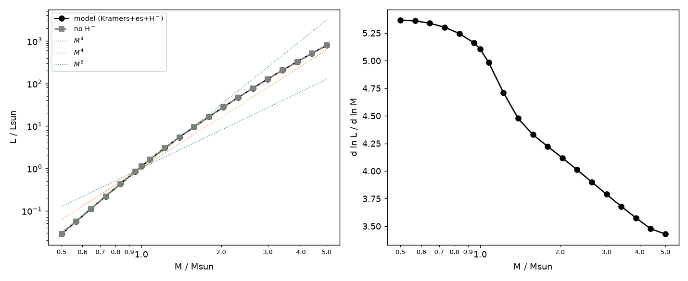
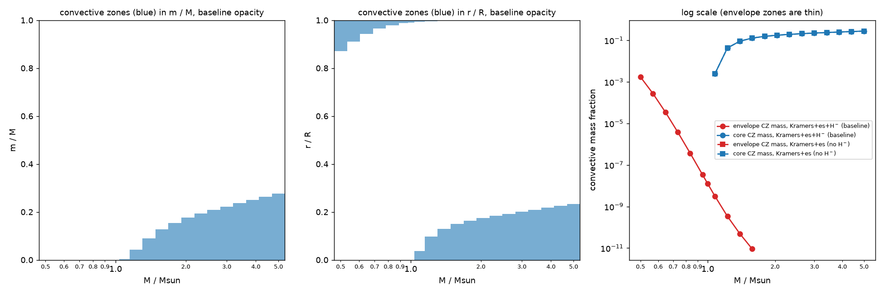

# A minimal stellar-structure code: the Sun and the 0.5–5 solar-mass main sequence

*Research question: Oriphim held-out test set. Computation, analysis and drafting: Ori (Oriphim), with an independent review.*

## Abstract

We built a code that solves the four equations of stellar structure for a static, chemically uniform star on the zero-age main sequence (ZAMS). It uses an ideal-gas-plus-radiation equation of state, analytic (Kramers-type) opacities, pp-chain and CNO-cycle burning, and the Schwarzschild criterion for convection. Models are found by shooting from the centre and from the surface to a fitting point, starting from an $n=3$ polytrope. The 1 $M_\odot$ model converges to a fit mismatch of 3e-08. It has $L =$ 1.11 $L_\odot$, $R =$ 0.94 $R_\odot$, a central temperature of 1.46e+07 K and a central density of 91 g cm$^{-3}$. These are within tens of per cent of the real ZAMS Sun, with the luminosity about 60 % too high. Over 0.5–5 $M_\odot$ the luminosity rises steeply with mass. The local power-law slope $d\ln L/d\ln M$ falls from 5.37 to 3.43, moving from the Kramers-opacity limit (5.5) towards the electron-scattering limit (3). A convective core appears between 1.00 and 1.08 $M_\odot$, as CNO burning grows in importance, and grows to 28% of the mass at 5 $M_\odot$. The envelope convection zones follow the right trend, but they are far too thin: this is a known consequence of the simple opacities, not a prediction.

## 1. Question and why it matters

A main-sequence star is a ball of gas in balance. Gravity is held off by pressure, and the energy made by fusion in the core must be carried out by radiation or by convection. Four coupled equations describe this balance: mass continuity, hydrostatic equilibrium, energy generation and energy transport. Solving them with a few physical ingredients is the classic test of whether those ingredients explain the broad facts of stars. These facts are that bright stars are much more massive than faint ones (the mass–luminosity relation), and that heavier stars have convective cores while lighter ones have convective envelopes. Where the convection lies matters because it mixes the star and so controls how it evolves. The question here was: build such a code, validate it, model the Sun, and sweep 0.5–5 $M_\odot$ to recover the mass–luminosity relation and the convective zones. The code also reports the Gamow peak, which is the energy at which nuclear reactions actually happen.

## 2. Method in brief

The full agreed set-up is in `PLAN.md`. The equations are integrated in the mass coordinate with scipy's LSODA solver (relative tolerance $10^{-9}$). The ingredients are:

- **Gas:** fully ionized ideal gas plus radiation pressure, with $X=0.70$, $Z=0.02$ (an assumption).
- **Opacity:** Kramers bound-free and free-free opacity plus electron scattering, combined with an H$^-$ fit. The H$^-$ term goes beyond "Kramers-type": without it, no envelope can become convective at all.
- **Burning:** pp and CNO rates from Kippenhahn, Weigert & Weiss (2012), without electron screening.
- **Convection:** where the radiative gradient exceeds the adiabatic one, the temperature gradient is set to the adiabatic value.

Centre series expansions and a grey Eddington photosphere give the boundary conditions. A Newton iteration on central pressure, central temperature, radius and luminosity matches the two integrations at half the mass. The $n=3$ Eddington standard model supplies the first guess (central temperature 1.21e+07 K for 1 $M_\odot$). The sweep uses 20 masses and continues each model from its neighbour. A second sweep without H$^-$ tests how much the surface opacity matters. Convective boundaries are found by root-finding where the radiative and adiabatic gradients are equal.

## 3. Results

**The 1 $M_\odot$ model.** It has $T_{\rm eff} =$ 6091 K, central pressure 1.79e+17 dyn cm$^{-2}$, and a gas-pressure fraction at the centre of 0.9994. The CNO cycle makes 0.8% of the luminosity. There is no convective core. The envelope convection zone holds only 1.2e-08 of the mass, with its base at $r/R =$ 0.991. In the real Sun it holds about 2–3 % of the mass and starts at about 0.7 $R$. At the central temperature ($kT =$ 1.25 keV), the Gamow peak is at 5.79 keV for p+p and at 26.1 keV for p+$^{14}$N. The rates' temperature sensitivities at 15 MK are $\nu_{pp} =$ 3.96 and $\nu_{\rm CNO} =$ 19.9.

**Mass–luminosity relation (Fig. 1).** $L$ rises from 0.028 $L_\odot$ at 0.5 $M_\odot$ to 791 $L_\odot$ at 5 $M_\odot$. The local slope bends smoothly down as electron scattering replaces Kramers opacity in the interior. Removing H$^-$ leaves $L$ almost unchanged (791 $L_\odot$ at 5 $M_\odot$; 0.02816 against 0.02817 $L_\odot$ at 0.5 $M_\odot$): the luminosity is set by the interior, not by the surface. This holds for stars with radiative envelopes; real stars below about 0.8 $M_\odot$ have deep convective envelopes, so $L$ at the low-mass end carries a (weaker) version of the surface caveats in Sec. 5.



**Convective zones (Fig. 2).** A convective core appears between 1.00 and 1.08 $M_\odot$. At 1.08 $M_\odot$ it is a small core, very sensitive to mass, holding 0.25% of the mass; it reaches 13% at 1.58 $M_\odot$ and 28% at 5 $M_\odot$. Over the same range the CNO share of $L$ rises from 2% to 98%. The steep temperature dependence of CNO burning concentrates the energy release near the centre, which makes the radiative gradient there exceed the adiabatic one. The envelope zone is deepest at 0.5 $M_\odot$ (1.7e-03 of the mass). It shrinks by about five orders of magnitude between 0.5 and 1 $M_\odot$ and is gone above about 1.6–1.8 $M_\odot$. Without H$^-$ there is no envelope convection at any mass.



## 4. How it was checked

Two sets of tests support the results: 9 unit tests, and 28 pass/fail checks by the independent Sceptic (`tests/checks/`). 25 of these were written before the main run, and 3 convergence checks were added at the first review. The Sceptic's checks re-implement the gas, opacity and burning formulas independently and verify the following:

- **Polytropes:** the Lane–Emden constants. For $n=3$ the code gives $\xi_1 =$ 6.89685 and $\rho_c/\bar\rho =$ 54.18.
- **Gamow peaks:** they agree with the textbook formula.
- **Conservation:** the virial theorem holds (1 $M_\odot$ ratio 0.99999999), and so does energy conservation ($L/\int\varepsilon\,dm =$ 0.9999999).
- **Structure equations and boundaries:** re-integrating the four equations from the stored profiles reproduces them, and the surface rows match the photosphere boundary condition.
- **Numerical convergence:** re-solving with 100× tighter tolerance and a different fitting point changes $L$, $R$ and $T_c$ by less than $10^{-4}$.

**What the Sceptic flagged and what changed.** At its first review the Sceptic found that the promised convergence re-solves were missing from its own checks file, so the first passing run had no convergence check. It added them, and one failed. The tiny convective core at 1.08 $M_\odot$ moved by 6 % when the fitting point moved, against a 2 % tolerance. The cause was that zone boundaries were read off the profile grid, whose spacing there is about 9 %. The fix was to root-find each boundary on the dense ODE solution, leaving the physics unchanged. After the fix the core mass is the same to about 8 digits for grids of 150–2400 points and for both fitting points. All 37 tests pass. The Sceptic also flagged that the small core near onset is physically very sensitive to mass: a 0.03 % change in $M$ shifts it by about 2 %. It found no code bug and nothing left suspect.

## 5. What it does not show

The full list is in `LIMITS.md`.

- **Not the solar convection zone.** The 1 $M_\odot$ envelope zone is orders of magnitude too thin. A deep zone needs the large real opacity at $10^5$–$2\times10^6$ K and the lowered adiabatic gradient in ionization zones, and neither is modelled. No envelope depth in the sweep, and not the 1.6–1.8 $M_\odot$ mass where the envelope zone vanishes, may be quoted as a prediction.
- **Luminosity and radius only to tens of per cent.** The 1 $M_\odot$ model is about 60 % too bright and about 400 K too hot, compared with the real ZAMS Sun (about 0.7 $L_\odot$).
- **Low-mass surface is unreliable.** At 0.5 $M_\odot$, $T_{\rm eff}$ (2781 K) and $R$ are wrong: there are no molecules, and the H$^-$ fit is used outside its range. Above about 1.5 $M_\odot$ the H$^-$ fit is also misapplied at the surface, but $L$ and the interior are unaffected.
- **Core onset is marginal.** At 1 $M_\odot$ the centre is about 3 % short of convective instability. The onset mass (here 1.00–1.08, published about 1.1–1.2 $M_\odot$) depends on screening, opacity and composition, and it is bracketed only by the sweep spacing.
- **The slopes belong to this opacity law.** The slopes are not fits to observed stars. Radiation pressure is negligible over this range, so the high-mass turnover is untested.
- **Scope.** The models assume uniform composition at zero age. They include no evolution, screening, partial ionization or mixing-length convection. Masses outside 0.5–5 $M_\odot$ and other compositions were not tested.

## 6. Reproducing it

```
uv venv .venv && uv pip install --python .venv/bin/python numpy scipy matplotlib pytest
.venv/bin/python run.py                 # about 16 s; writes results/
.venv/bin/python -m pytest tests -q     # unit tests and the Sceptic's checks
```

All numbers in this paper are filled from `results/summary.json` and `results/sweep_table.csv`. Per-mass profiles are in `results/profiles/`.
